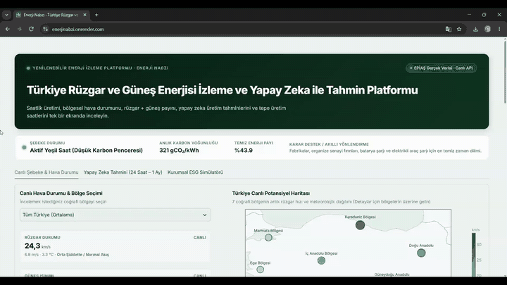

# Enerji Nabzi: Turkiye Clean Energy Intelligence & Live Grid Analytics Platform

Enerji Nabzi is an enterprise-grade energy intelligence and grid analytics platform designed to monitor, forecast, and analyze renewable electricity generation across Turkiye's national grid in real time. Aligned with COP31 climate benchmarks and the EU Carbon Border Adjustment Mechanism (CBAM / SKDM), the system combines live grid telemetry, 100-meter altitude meteorological observations across 7 geographical regions, sub-second multi-horizon machine learning forecasting, and corporate Scope-2 greenhouse gas abatement simulations.



---

## Core Modules & Capabilities

### 1. Real-Time Grid Monitoring & Regional Potential Map
- **National Grid Integration:** Real-time ingestion of national electricity generation (Wind, Solar, Total Generation, and Renewable Share) sourced from the EPİAS Transparency Platform.
- **Regional Meteorological Telemetry:** High-resolution 15-minute observations for Turkiye's 7 geographical regions (Marmara, Aegean, Central Anatolia, Mediterranean, Black Sea, Southeastern Anatolia, Eastern Anatolia) powered by Open-Meteo satellite and numerical weather prediction models (ECMWF & DWD):
  - 100-meter hub-height wind speed (km/h and m/s)
  - Ambient 2-meter temperature (Celsius)
  - Cloud cover fraction (%)
  - Direct Normal Irradiance (DNI - W/m²)
- **Geospatial Mapping:** Interactive Plotly Mercator projection visualizing regional wind power density with responsive proportional marker scaling and regional basin metadata.

### 2. Multi-Horizon Machine Learning Forecaster (Ridge AI)
- **Architecture & Performance:** Employs an L2-regularized linear Ridge Regression architecture optimized for sub-100ms inference latency across all forecasting horizons, eliminating GPU dependency and ensuring instant page rendering.
- **Planning Horizons:**
  - **24-Hour (Day-Ahead Market / DAM):** Hourly dispatch curves and peak load/generation windows.
  - **7-Day (Weekly Operational Horizon):** 168-hour lookahead for grid balancing and base-load variance analysis.
  - **30-Day (Monthly Horizon):** 720-hour strategic outlook with daily aggregation and seasonal transition trends.
- **Physical Feature Engineering:**
  - **Solar Elevation Flux:** Calculates instantaneous solar elevation angles and atmospheric optical mass based on geographical coordinates and day-of-year solar declination.
  - **Diurnal Persistence:** Models cyclical 24-hour diurnal wind oscillations and atmospheric boundary layer dynamics.

### 3. Corporate ESG Scope-2 & CBAM (SKDM) Simulator
- **Accounting Methodology:** Location-based and market-based Scope-2 indirect emission accounting conforming to the GHG Protocol Corporate Standard.
- **Grid Emission Intensity:** Benchmark national grid emission factor of 0.45 tCO2e/MWh (450 gCO2/kWh).
- **Financial Carbon Valuation:** Models corporate tax liability mitigation under the EU Emissions Trading System (EU ETS / EUA) and CBAM mechanisms (e.g., 85 EUR/tCO2e baseline).
- **Audit-Ready Reporting:** Generates downloadable corporate carbon scorecards and structured CSV datasets for sustainability audits and green bond financing.

---

## Data Pipeline & Autonomous Synchronization

The platform does not depend on static data dumps. It operates an automated, self-healing continuous integration and data harvesting pipeline:

```
[EPİAS Transparency Platform] ---> [GitHub Actions Workflow] ---> [update_pipeline.py]
                                                                        |
                                                                        v
[Web Dashboard (Render & Streamlit)] <--- [src/epias_csv.py] <--- [data/temiz_epias_uretim.csv]
```

- **Hourly Automation (`hourly_update.yml`):** Runs every hour at minute 18, queries EPTR2 client libraries for recently settled hourly production figures, cleans non-finalized hours, and appends valid records to `data/temiz_epias_uretim.csv`.
- **Daily Calibration (`daily_update.yml`):** Runs at 22:00 UTC daily to verify full 24-hour completion and rebalances the diurnal baseline profile in `data/saatlik_profil.csv`.
- **Data Repository:**
  - `data/temiz_epias_uretim.csv`: 8,760+ hourly continuous time series of verified national generation.
  - `data/saatlik_profil.csv`: 24-hour normalized diurnal characteristic curve.

---

## Technology Stack

- **Core Engine:** Python 3.11
- **Dashboard Framework:** Streamlit
- **Data Engineering:** Pandas, NumPy
- **Machine Learning:** Scikit-learn (Ridge Regression, StandardScaler)
- **Data Visualization:** Plotly Graph Objects
- **Grid Telemetry API:** EPTR2 (EPİAS API Client)
- **Meteorological API:** Open-Meteo REST API
- **Continuous Integration / Pipeline:** GitHub Actions
- **Cloud Infrastructure:** Render (Primary Production), Streamlit Community Cloud (Secondary / Failover)
- **Uptime Monitoring:** UptimeRobot, cron-job.org (7/24 Continuous High-Availability)

---

## Repository Directory Structure

```
enerji/
├── .github/
│   └── workflows/
│       ├── hourly_update.yml     # Hourly EPİAS synchronization workflow
│       └── daily_update.yml      # Daily profile recalibration workflow
├── .streamlit/
│   └── config.toml               # Streamlit server and proxy configuration
├── data/
│   ├── temiz_epias_uretim.csv    # 8,760+ hourly national grid database
│   └── saatlik_profil.csv        # 24-hour diurnal profile characteristics
├── src/
│   ├── epias_csv.py              # Timezone-aware CSV loader & date parser
│   ├── esg_analytics.py          # ESG Scope-2 and CBAM financial engine
│   ├── forecast_engine.py        # Live regional meteorological engine
│   ├── ml_forecaster.py          # Multi-horizon Ridge ML forecasting engine
│   └── data_helper.py            # Data abstraction utilities
├── app.py                        # Main analytics dashboard application
├── update_pipeline.py            # Automated EPİAS ingestion pipeline script
├── requirements.txt              # Production dependency specifications
├── linkedincop31.gif             # Platform demonstration animation (33MB)
└── README.md                     # Technical system documentation
```

---

## Installation & Local Execution

### Prerequisites
- Python 3.10 or higher
- Git

### Quickstart

1. Clone the repository:
```bash
git clone https://github.com/emrealtindag/energy-turkiye.git
cd energy-turkiye
```

2. Create and activate a virtual environment:
```powershell
python -m venv .venv
# Windows PowerShell:
.\.venv\Scripts\Activate.ps1
# Linux / macOS:
source .venv/bin/activate
```

3. Install production dependencies:
```bash
pip install -r requirements.txt
```

4. Launch the dashboard:
```bash
streamlit run app.py
```

The application will be accessible at `http://localhost:8501`.

---

## Live Deployments

- **Primary Production (Render):** https://enerjinabzi.onrender.com
- **Failover / Mirror (Streamlit Cloud):** https://enerjinabzi.streamlit.app
